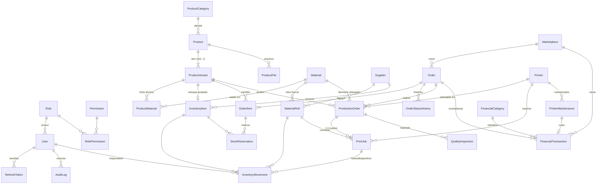

# Alipe3D Manager — Planejamento técnico

> Documento vivo. Atualizado a cada fase. Versão: **Fase 4 — Impressoras e produção**.

## 1. Arquitetura

**Monólito modular em monorepo** (npm workspaces), 100% TypeScript.

```text
┌──────────────────────────┐   /api/v1 (JSON)   ┌───────────────────────────┐   Prisma   ┌──────────────┐
│ apps/frontend            │ ─────────────────▶ │ apps/backend              │ ─────────▶ │ PostgreSQL 18│
│ React 19 + Vite 8        │  proxy Vite (dev)  │ Express 5 + Zod + Pino    │  adapter-pg└──────────────┘
│ TanStack Query + Axios   │  nginx (produção)  │ módulos: routes→controller│
│ Tailwind 4 (tokens)      │                    │ →service→repository       │
└────────────┬─────────────┘                    └────────────┬──────────────┘
             └──────────── packages/shared (tipos + schemas Zod) ┘
```

Decisões principais:

| Decisão                                                                                                          | Motivo                                                                                                          |
| ---------------------------------------------------------------------------------------------------------------- | --------------------------------------------------------------------------------------------------------------- |
| Frontend chama sempre `/api/v1` relativo (proxy Vite em dev, nginx em produção)                                  | Mesma origem: sem CORS no navegador e cookies `httpOnly` funcionam para o refresh token (Fase 2).               |
| `packages/shared` com schemas Zod                                                                                | O mesmo schema valida no backend e tipa/valida no frontend. Regras de negócio **não** ficam aqui, só contratos. |
| Dependências injetadas em `createApp()`                                                                          | Testes de integração HTTP sem banco real (ver `health.test.ts`).                                                |
| Prisma 7 com `@prisma/adapter-pg`                                                                                | Client sem engine Rust, roda em Alpine; migrations versionadas em `apps/backend/prisma/migrations`.             |
| Resposta padrão `{ success, data, meta? }` / `{ success: false, error: { code, message, details?, requestId } }` | Tratamento uniforme no cliente; `requestId` liga o erro da tela ao log.                                         |
| Valores monetários `Decimal(12,2)` e pesos `Decimal(10,2)`                                                       | Nunca `float` para dinheiro. Serializados como string na API.                                                   |
| Integrações externas (Shopee, TikTok Shop, Bambu Lab) em módulos isolados com interface própria                  | A v1 é manual; a integração entra depois sem tocar nos módulos de domínio.                                      |

### Padrão de módulo do backend

```text
modules/<modulo>/
  <modulo>.routes.ts       # rotas + middlewares (auth, permissão, validação)
  <modulo>.controller.ts   # HTTP in/out, sem regra de negócio
  <modulo>.service.ts      # regras de negócio e transações
  <modulo>.repository.ts   # acesso ao Prisma (quando a consulta não for trivial)
  <modulo>.schemas.ts      # schemas Zod de entrada (ou em packages/shared)
  <modulo>.test.ts
```

## 2. Estrutura de pastas (atual)

```text
alipe3d-manager/
├── apps/
│   ├── backend/
│   │   ├── prisma/schema.prisma        # datasource + generator (modelos a partir da Fase 2)
│   │   ├── prisma.config.ts            # configuração do Prisma 7 (lê o .env da raiz)
│   │   ├── src/
│   │   │   ├── config/                 # env (validado com Zod), logger
│   │   │   ├── docs/openapi.ts         # documento OpenAPI 3.1 (Swagger em /api/docs)
│   │   │   ├── middlewares/            # erro centralizado, 404
│   │   │   ├── modules/health/         # health check (routes/controller/service/test)
│   │   │   ├── prisma/client.ts        # PrismaClient único
│   │   │   ├── routes/index.ts         # roteador /api/v1
│   │   │   ├── utils/                  # AppError, helpers de resposta
│   │   │   ├── generated/              # Prisma Client (gerado, fora do git)
│   │   │   ├── app.ts                  # montagem do Express
│   │   │   └── server.ts               # bootstrap + encerramento gracioso
│   │   └── Dockerfile
│   └── frontend/
│       ├── public/                     # favicon (logo oficial entra aqui)
│       ├── src/
│       │   ├── components/             # BrandMark, ui/Card, ui/StatusBadge
│       │   ├── modules/system/         # página de status (consumo real da API)
│       │   ├── pages/                  # NotFound
│       │   ├── services/api.ts         # Axios + normalização de erros
│       │   ├── utils/                  # formatação BRL/datas, cn()
│       │   ├── index.css               # tokens da identidade visual (@theme)
│       │   ├── router.tsx
│       │   └── main.tsx
│       ├── nginx.conf
│       └── Dockerfile
├── packages/shared/src/{types,schemas}
├── docs/ARQUITETURA.md
├── docker-compose.yml
├── .env.example
└── README.md
```

As pastas `layouts/`, `contexts/`, `hooks/` e os demais módulos são criados conforme cada fase os utilizar.

## 3. DER proposto

> Proposta para validação. Os modelos serão criados **fase a fase**, cada um com sua migration.



### Relacionamentos e decisões

- **Usuários:** `User → Role` (N:1); `Role ↔ Permission` via `RolePermission` (N:N). Perfis iniciais `ADMIN` e `OPERACIONAL`; permissões granulares no formato `modulo:acao` (ex.: `inventory:adjust`). `RefreshToken` guarda apenas o **hash** do token (rotação + revogação no logout). Recuperação de senha usa token de uso único, também em hash.
- **Toda venda e produção referencia `ProductVariant`.** Todo produto tem ao menos uma variação (a "padrão" quando não há cor/tamanho). Isso cumpre a regra "item associado a produto ou variação" com uma FK única e obrigatória, sem colunas opcionais ambíguas.
- **`Material` × `MaterialRoll`:** `Material` é o tipo (ex.: PLA Preto Bambu, custo médio por grama); `MaterialRoll` é o carretel físico (peso inicial, disponível, carretel vazio, custo, fornecedor, data de entrada). Estoque de filamento sempre em gramas.
- **`InventoryItem`:** insumos (embalagens, etiquetas, bicos, placas, componentes) **e** produtos acabados (`kind = SUPPLY | FINISHED_GOOD`, com `productVariantId` único no segundo caso).
- **`InventoryMovement`** é o livro-razão: tipo (`PURCHASE_IN`, `PRODUCTION_OUT`, `ADJUSTMENT`, `LOSS`, `WASTE`, `RETURN`, `PRODUCTION_IN`), quantidade, saldo resultante, responsável, data e referências opcionais (`printJobId`, `orderId`). Saldo negativo só com permissão `inventory:allow-negative`, registrado em `AuditLog`.
- **`StockReservation`** liga produto acabado a item de pedido (regra 8). Cancelamento libera a reserva sem apagar histórico (regra 9).
- **`PrintJob` é o histórico de impressão** — cada execução numa impressora (início, fim, rolo, gramas estimadas e reais, resultado, motivo de falha, gramas desperdiçadas, tempo perdido). Por isso **`PrintHistory` não será criada**: seria redundante.
- **Baixa de material sem duplicidade:** a baixa ocorre apenas ao **finalizar** um `PrintJob`, dentro de uma transação, com índice único (`referenceType`, `referenceId`, `type`, rolo/item) em `InventoryMovement`. Repetir a finalização não gera segunda baixa.
- **`ProductionOrderItem` não foi criada (decisão da Fase 4):** o escopo define a ordem com **um** produto, variação e quantidade. Um pedido com vários itens gera uma ordem por item (regra 3). A tabela de itens seria redundante.
- **`Order`:** restrição única `(marketplaceId, externalCode)` impede importação duplicada (regra 10). Mudanças de status geram `OrderStatusHistory`.
- **Financeiro:** proponho `FinancialCategory` (com `kind = INCOME | EXPENSE`) no lugar de `ExpenseCategory`, porque a regra 11 exige categoria também nas receitas. `FinancialTransaction` guarda valor bruto, taxas e líquido. `PricingConfiguration` guarda parâmetros (R$/kWh, consumo da impressora em W, custo-hora de máquina e de mão de obra, margem padrão); taxas de cada canal ficam em `Marketplace`.
- **Padrões gerais:** IDs `uuid` (v7, ordenáveis por tempo), `createdAt`/`updatedAt` em todas as tabelas, `deletedAt` (exclusão lógica) em cadastros (produtos, materiais, impressoras, fornecedores). Usuários nunca são excluídos: são **desativados** (`isActive`), preservando autoria em auditoria e históricos. Movimentações e históricos nunca são apagados.

## 4. Fluxos principais

1. **Pedido → produção:** pedido cadastrado/importado → itens vinculados a variações → se há estoque acabado, reserva; senão, gera ordem(ns) de produção.
2. **Produção:** ordem `PENDING` → `PLANNED` (impressora atribuída) → `IN_PROGRESS` (abre `PrintJob`) → `COMPLETED`/`FAILED` (baixa de filamento + entrada de produto acabado ou registro de desperdício, numa transação) → `INSPECTION` → `APPROVED`.
3. **Estoque:** compra gera entrada + despesa; produção gera saída; ajustes exigem motivo e ficam auditados.
4. **Precificação:** gramas × custo/g + energia (W × h × R$/kWh) + máquina + mão de obra + embalagem + taxas do canal → preço sugerido pela margem desejada, exibindo margem, markup e margem de contribuição separadamente. Cálculo no backend com `Decimal`.

### Autenticação e permissões (implementado na Fase 2)

```text
Login ──▶ access token JWT (15 min, só em memória) + cookie httpOnly com refresh token opaco (7 dias)
  │
  ├─ cada requisição: Authorization: Bearer → middleware recarrega o usuário do banco
  │     (desativação, troca de senha e mudança de permissões valem imediatamente)
  ├─ 401 → cliente chama /auth/refresh uma vez (requisição única compartilhada) e repete a chamada
  └─ refresh: token rotacionado; token antigo reapresentado após 30 s → revoga a família inteira
```

- **Perfis:** `ADMIN` tem todas as permissões implicitamente e não é editável. `OPERACIONAL` e perfis personalizados recebem permissões do catálogo em `packages/shared/src/permissions.ts`. Permissões `adminOnly` (usuários, perfis, auditoria) não podem ser atribuídas fora do `ADMIN`; a regra é validada no schema, no service e no seed.
- **Senha provisória:** usuários criados pelo administrador (e o administrador do seed) têm `mustChangePassword`. A API devolve `403 PASSWORD_CHANGE_REQUIRED` em qualquer rota, exceto `/auth/me`, `/auth/change-password` e `/auth/logout`, até a troca.
- **Proteções:** ninguém desativa a si mesmo nem altera o próprio perfil; o último administrador ativo não pode ser desativado nem rebaixado. Desativar encerra as sessões e invalida links de redefinição pendentes.
- **Recuperação de senha:** link de uso único (hash no banco). Por e-mail quando há SMTP (60 min); sem SMTP, o administrador gera o link na tela de usuários (24 h).
- **Auditoria:** `AuditLog` registra login (sucesso e falha), logout, troca e redefinição de senha, reuso de sessão e todas as operações de usuários e perfis, com autor, IP e detalhes sem dados sensíveis. A gravação ocorre na mesma transação da operação.
- **Testes:** os testes de integração (`npm run test:int`) cobrem esses fluxos contra um PostgreSQL real, em banco `_test` isolado.

### Produtos e estoque (implementado na Fase 3)

- **Herança produto → variação:** preço, peso, tempo e estoque mínimo ficam no produto; a variação guarda só o que for diferente (`null` = herda). A API devolve os valores próprios e os efetivos.
- **SKU único entre todas as variações.** A variação padrão usa o SKU do produto e o acompanha quando ele muda. SKUs de itens excluídos não são reaproveitados, para manter o histórico inequívoco.
- **Livro-razão único:** todo saldo (rolo em gramas, insumo e produto acabado em unidades) só muda pelo `MovementsService.apply`, que:
  1. trava a linha (`SELECT … FOR UPDATE`), então lançamentos simultâneos não leem o mesmo saldo (coberto por teste com 5 consumos paralelos);
  2. calcula o saldo e bloqueia saldo negativo, salvo autorização da permissão administrativa `inventory:allow-negative`, que fica auditada;
  3. grava `balanceAfter` e o custo do lançamento (custo por grama do rolo ou custo médio do insumo);
  4. roda dentro da transação de quem chamou. As próximas fases (produção, pedidos) usam o mesmo método, preenchendo `referenceType` e `referenceId`.
- **Tipos de movimentação permitidos por item** (`ALLOWED_MOVEMENTS`, compartilhado entre API e tela): rolos entram pelo cadastro do rolo; produtos acabados, até a Fase 4, entram por ajuste manual. Ajuste exige a permissão `inventory:adjust`.
- **Rolo de filamento:** recebe código sequencial (`R-0001`, sequência no PostgreSQL), custo por grama = custo ÷ peso inicial e situação automática (lacrado → em uso → vazio). A **pesagem** desconta o carretel vazio e lança a diferença como ajuste. Descartar exige zerar o saldo antes, como perda ou desperdício.
- **Custo médio ponderado** dos insumos é recalculado a cada entrada por compra com custo informado.
- **Alertas:** filamento abaixo do mínimo (crítico se zerado), rolo abaixo de 100 g, insumo e produto acabado abaixo do mínimo. Calculados na hora pela API e exibidos na visão geral do estoque e no sino do cabeçalho.
- **Arquivos de produto:** gravados em `UPLOAD_DIR` com nome gerado pelo sistema. A validação confere extensão, tamanho por tipo e assinatura real do conteúdo (ex.: um `.png` que não é PNG é recusado). O download exige login, sai como anexo (só imagens podem ser exibidas na tela) e o nome segue a RFC 6266. A primeira imagem vira capa.
- **Integridade no banco** (SQL manual na migration, invisível para o Prisma e já conferido com `prisma migrate diff`): movimentação com exatamente um alvo e quantidade ≠ 0; ficha técnica com exatamente um componente; item acabado ⇔ variação; no máximo uma variação padrão por produto; combinação de atributos única por produto.

### Impressoras e produção (implementado na Fase 4)

- **Situação da impressora:** a situação cadastrada é `AVAILABLE`, `MAINTENANCE` ou `INACTIVE`. "Imprimindo" e "Pausada" não são gravadas: vêm da impressão em andamento, então não ficam dessincronizadas. Não dá para pôr em manutenção uma impressora que está imprimindo.
- **Horas acumuladas** = horas iniciais (contador da máquina no cadastro) + soma do tempo efetivo das impressões finalizadas (sem as pausas).
- **Ciclo da ordem:** `PENDING` (sem impressora) → `PLANNED` (com impressora) → `IN_PROGRESS`/`PAUSED` (impressão em andamento) → `COMPLETED` (tudo impresso) → `INSPECTION` (opcional) → `APPROVED`. Sem nenhuma peça aprovada e nada mais a imprimir: `FAILED`. Antes de imprimir: `CANCELLED` (estado acrescentado à lista do escopo, necessário para cancelar sem apagar histórico).
- **Contadores da ordem:** planejadas, impressas, aprovadas, reprovadas e dispensadas. Falta imprimir = planejadas − dispensadas − (impressas − reprovadas). A próxima situação é calculada por uma função pura (`production-rules.ts`, com testes unitários).
- **Dispensadas:** reprovadas sem refabricação, falhas sem refazer, ou o que faltava quando a produção foi encerrada antes do fim. Encerrar uma parte não cancela peças que ainda nem foram impressas.
- **Uma impressão por vez:** índices únicos parciais garantem no máximo uma impressão em andamento por impressora e por ordem. O início trava a linha da impressora (`FOR UPDATE`).
- **Baixa de filamento:** só ao finalizar, pelo peso real informado, um lançamento por rolo (troca de rolo ou multicor). Falha gera `WASTE`; sucesso gera `PRODUCTION_OUT`. A linha da impressão é travada e o índice único do livro-razão impede a segunda baixa (teste com 5 finalizações simultâneas: 1 aceita, 4 recusadas).
- **Inspeção:** aprovadas geram `PRODUCTION_IN` no produto acabado e baixam os insumos da ficha técnica (caixa, etiqueta) na mesma transação. Sem insumo suficiente, nada é gravado (saldo negativo só com autorização administrativa auditada).
- **Alertas** (sino): estoque, manutenção vencida ou prevista em até 7 dias, e ordens atrasadas, conforme as permissões de cada usuário.
- **Bambu Lab A1:** controle manual. Nenhuma comunicação com a impressora é simulada (ver seção 6).
- **Pedido de origem:** o vínculo entre ordem e pedido entra na Fase 5, junto com a tabela de pedidos.
- **Custo de manutenção:** registrado na manutenção. O lançamento no financeiro entra na Fase 6.

> **Atenção nas próximas migrations:** sempre revisar o SQL gerado. Os índices parciais e as restrições `CHECK` acima não estão no `schema.prisma`.

## 5. Cronograma técnico

| Fase | Entrega                                                                                             | Situação             |
| ---- | --------------------------------------------------------------------------------------------------- | -------------------- |
| 1    | Fundação: monorepo, front/back, Postgres/Prisma, Docker, health check                               | **Concluída**        |
| 2    | Identidade visual, login JWT + refresh, layout com sidebar, usuários, perfis, permissões, auditoria | **Concluída**        |
| 3    | Produtos, categorias, variações, arquivos, ficha técnica, materiais, rolos, insumos, movimentações  | **Concluída**        |
| 4    | Impressoras, manutenção, ordens de produção, fila, `PrintJob`, falhas, baixa de material            | **Concluída**        |
| 5    | Marketplaces, pedidos, itens, status, reservas, geração de OPs, importação CSV                      | Aguardando validação |
| 6    | Receitas, despesas, precificação, dashboard com dados reais, relatórios + CSV                       | —                    |
| 7    | Testes E2E, ajustes, configuração de produção, backup, implantação                                  | —                    |

## 6. Integrações futuras (não implementadas)

- **Shopee / TikTok Shop:** somente pelas APIs oficiais (Shopee Open Platform e TikTok Shop Partner Center), que exigem cadastro de aplicativo e autorização da loja. Até lá: cadastro manual e importação de planilhas exportadas pelas plataformas. Sem scraping.
- **Bambu Lab A1:** a ser avaliada antes da implementação — a comunicação local depende do modo LAN/desenvolvedor da impressora e das políticas de autorização de firmware da Bambu Lab. Na v1 o controle é manual; nenhuma comunicação será simulada.

## 7. Dependências

| Área         | Pacotes (versões fixadas)                                                                                                                                                                                                 |
| ------------ | ------------------------------------------------------------------------------------------------------------------------------------------------------------------------------------------------------------------------- |
| Frontend     | react 19.3, vite 8.3, @vitejs/plugin-react 6.2, tailwindcss 4.3, react-router-dom 7.18, @tanstack/react-query 5.106, axios 1.21, react-hook-form 7.91, @hookform/resolvers 7.0, zod 4.6, recharts 3.10, lucide-react 1.69 |
| Backend      | express 5.3, prisma / @prisma/client / @prisma/adapter-pg 7.10.1, pg 8.23, zod 4.6, helmet 8.3, cors 2.8, express-rate-limit 8.7, pino 10.4, pino-http 11, swagger-ui-express 5                                           |
| Autenticação | jsonwebtoken 9.0, bcrypt 6.0, cookie-parser 1.4, nodemailer 10.3 (SMTP opcional); socket.io entra quando houver necessidade de tempo real                                                                                 |
| Ferramentas  | typescript 6.0.3, eslint 10 + typescript-eslint 8.72, prettier 3.9, vitest 5.1, supertest 7.3, tsx 4.23, concurrently 10                                                                                                  |
| Infra        | Node 24+ (testado no 26 LTS), PostgreSQL 18, Docker Compose, nginx 1.29                                                                                                                                                   |

Notas de versão:

- **TypeScript 6.0.3** (e não 7.x): o `typescript-eslint` ainda só suporta TS < 6.1.
- **Prisma 7.10.1** (e não 8): a tag `latest` do npm aponta para um release candidate da 8.
